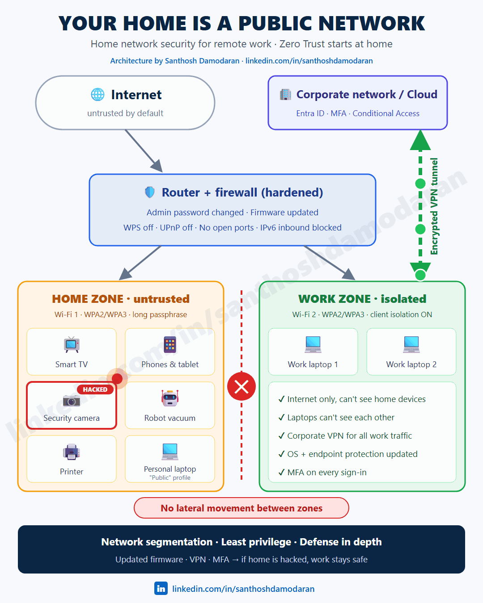

# Zero Trust Home Network for Remote Work

**Your home is a public network.** This repo shows how I audited and segmented my own home network, so that a hacked TV, camera or robot vacuum can't reach the laptops I use for work. It uses only the ISP router I already had, with no new hardware.

By **Santhosh Damodaran**, Integration Architect (Azure · AI agents · secure integration)
[linkedin.com/in/santhoshdamodaran](https://www.linkedin.com/in/santhoshdamodaran)  
📣 Read the LinkedIn post: [Your home is a public network](https://lnkd.in/p/dE2ErKZY)

---

## Why this matters now

A modern home has 15+ connected devices: smart TV, phones, tablets, cameras, a robot vacuum, voice assistants, a printer. Each has its own firmware, cloud account and update cycle, and **none of them is managed by IT**. On a single "flat" Wi-Fi, every one of them can reach the work laptop: the one device that holds VPN access, cloud credentials and production keys.

Real incidents where one engineer's machine became the way in:

| Incident | What happened | Lesson |
|---|---|---|
| **Binance, Oct 2026** (~$6.3B) | A fake job interview got an engineer to run a "coding test" containing malware that endpoint tools missed. From that device, attackers used an **internal AI tool** to compromise two more colleagues and reached the wallet signing service. | One device + lateral movement = the business. AI agents widen the blast radius. |
| **LastPass, 2022** | A DevOps engineer's **home computer** was hacked through an unpatched media-server app. A keylogger captured the master password, and the company's vault backups were stolen. | The home network and personal devices are part of the corporate attack surface. |

Sources and details: [docs/research.md](docs/research.md)

## Architecture

| Zone | Devices | Controls |
|---|---|---|
| **Home zone (untrusted)** | TV, phones, tablet, camera, robot vacuum, printer, personal laptop | WPA2/WPA3, long passphrase, firmware updates, MFA on every device's cloud account, personal laptop on the Windows *Public* profile |
| **Work zone (isolated)** | Work laptops only | A separate Wi-Fi (the router's guest network) on its **own subnet**: internet only, no route to the home zone or the router admin page, plus corporate VPN for all work traffic |
| **Router / firewall** | ISP gateway | Admin password changed, WPS off, UPnP off, no port forwards / DMZ, IPv6 inbound blocked, WAN ping replies off |

Principles: **network segmentation · least privilege · defense in depth · assume breach**.
The goal: *if the home network is compromised, the work device shouldn't even be visible.*

> **Honest limit:** segmentation limits the blast radius at home. It would not have stopped the Binance malware, which the engineer ran on their own device. Identity, endpoint security and least privilege protect the work itself. See [limits-and-faq.md](docs/limits-and-faq.md).

**Want to do this at home?** Start with the [15-minute quick start](docs/quick-start.md).

## What I found and decided (the real part)

The audit found more than a checklist would predict:

- **The printer was running its own Wi-Fi hotspot** ("Wireless Direct"), a side door around every Wi-Fi rule. Fix: turn it off on the printer.
- **The router had WPS on, a factory-default admin password and a short numeric Wi-Fi password.** These are the defaults most homes still run with.
- **The guest network has no "client isolation" switch** in this router's UI. I didn't trust the marketing, so I *tested* it: from the work zone, every home device and the router admin page are unreachable, and only DNS answers. See [docs/verification.md](docs/verification.md).
- **Some router settings are ISP-managed** (remote management via TR-069) and can't be turned off by the customer. That's accepted risk; the ISP is part of the trust boundary.
- **Firewall level:** "High" also restricts *outgoing* ports and breaks camera/vacuum apps, VPNs and games. I kept "Medium" (unknown inbound dropped, IPv4 and IPv6), and checked that the IPv6 pinhole table is empty.
- **Trade-offs I chose on purpose:**
  - The phones stay in the home zone next to the IoT devices, because casting and local control need the same network.
  - The work laptops can't print to the home printer. That's the price of isolation.
  - Two networks, not three: the ISP router can't do VLANs. A dedicated IoT network on my own router is the next step.

## Docs

| File | What's in it |
|---|---|
| [docs/quick-start.md](docs/quick-start.md) | **Start here:** the 15-minute version (6 steps) |
| [docs/router-guide.md](docs/router-guide.md) | Will this work on my router? A decision guide, fallbacks and where the settings live (TP-Link, ASUS, NETGEAR, FRITZ!Box, Eero, ISP routers) |
| [docs/runbook.md](docs/runbook.md) | Step-by-step setup you can repeat for any house and any router |
| [docs/security-checklist.md](docs/security-checklist.md) | Router + device hardening checklist (template) |
| [docs/verification.md](docs/verification.md) | How to *prove* the segmentation works (Windows, macOS and Linux tests) |
| [docs/limits-and-faq.md](docs/limits-and-faq.md) | What segmentation does **not** protect against, plus common problems and fixes |
| [docs/research.md](docs/research.md) | Breach case studies with sources |

## The diagram

- `diagram/diagram.svg`: the source (hand-written SVG)
- `diagram/diagram.gif`: a seamless 3.2 s loop. The diagram stays still; only the flows move (the attack is blocked, VPN packets flow)
- `diagram/diagram.png`: a static 2160×2700 version
- `diagram/diagram.drawio`: an editable version. Open it at [app.diagrams.net](https://app.diagrams.net), then use *File → Export as → VSDX* to get a Visio file

## Out of scope / next steps
- A dedicated IoT VLAN on a router I own (OpenWrt / UniFi class), with DNS filtering
- Per-device firewall rules and a monitoring pass (who talks to whom)
- An endpoint posture check for personal devices before they touch anything work-related

## License
[CC BY 4.0](https://creativecommons.org/licenses/by/4.0/): reuse freely **with attribution to Santhosh Damodaran**. See [LICENSE](LICENSE).

No passwords, network names, IP addresses or device identifiers from my real network are published here.
